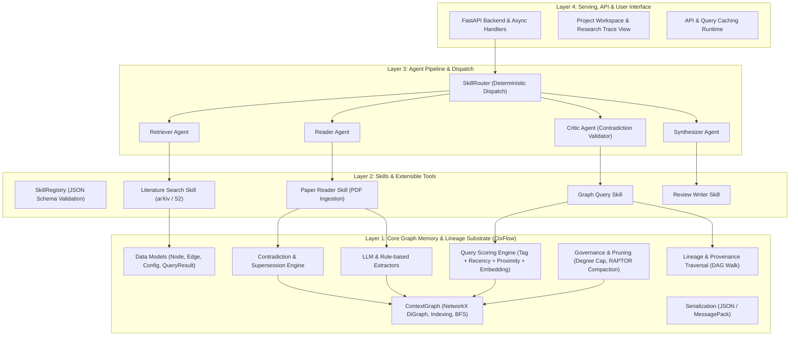
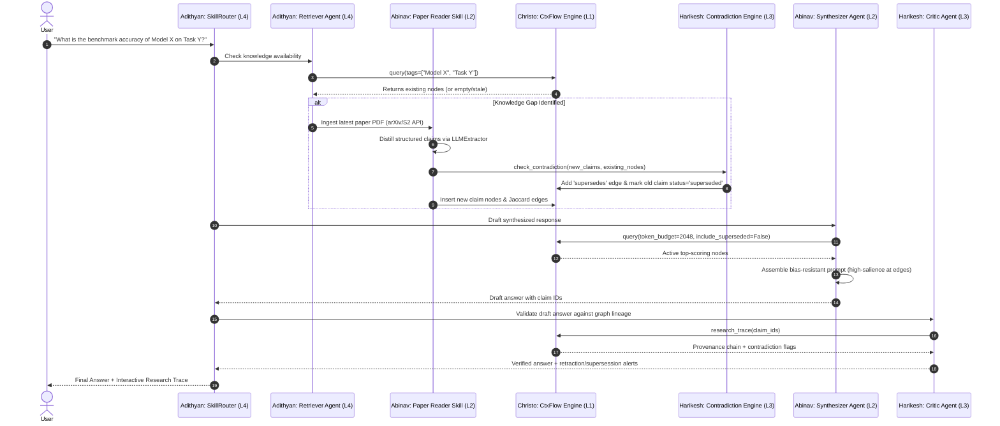
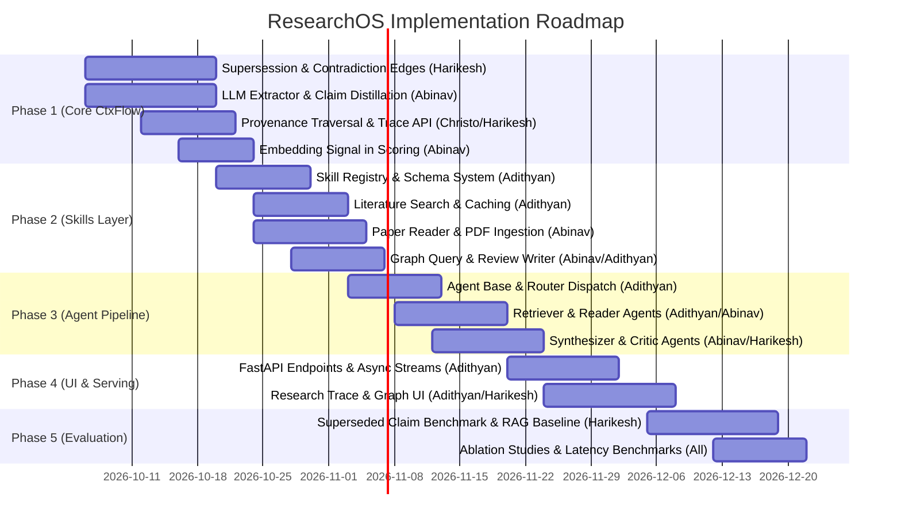

# ResearchOS / CtxFlow: Layered Architecture, Module Ownership & Implementation Strategy

> **Unified Specification Document**: This single document outlines the end-to-end architecture, module distribution, seminar alignment, and implementation strategies for the **CtxFlow → ResearchOS** platform. It is designed to provide complete context for any general LLM or engineer navigating the codebase.

---

## 1. Executive Summary & System Vision

**CtxFlow** is a graph-native context memory engine designed for LLM agents to maintain structured, evolving knowledge across long research sessions without context degradation. **ResearchOS** expands CtxFlow into a multi-agent autonomous scientific research operating system capable of literature search, paper comprehension, contradiction detection, truth maintenance, and verifiable citation tracing.



---

## 2. Seminar Alignment & Team Ownership Overview

The codebase is partitioned into four functional layers, each directly mapped to a team member's seminar research topic:

| Owner | Seminar Title | Core Architectural Focus | Key Codebase Domain |
|---|---|---|---|
| **Christo** | *Memory Architectures for LLM-Based Agents* | Core Graph Memory Substrate, Topology, State Persistence & Compaction | `models.py`, `graph.py`, `pruning.py`, `governance.py`, `serialization.py` |
| **Abinav** | *Context Window Utilization and Positional Bias in LLMs* | Query-Time Assembly, Multi-Signal Scoring, Token Budgeting & Bias-Resistant Prompt Packing | `query.py`, `llm_extractor.py`, `skills/paper_reader.py`, `agents/synthesizer.py`, `skills/review_writer.py` |
| **Harikesh** | *Data Lineage and Correction Propagation for Responsible AI Systems* | Contradiction Detection, Supersession Dynamics, Provenance Traversal & Truth Maintenance | `contradiction.py`, `graph.py` (`trace_provenance`), `__init__.py` (`research_trace`), `agents/critic.py`, `eval/` |
| **Adithyan** | *Cache-Aware Serving and Token-Budgeted Retrieval for LLM Agents* | Skill Execution Runtime, Deterministic Agent Routing, External API Caching & Serving Infrastructure | `skills/registry.py`, `skills/literature_search.py`, `skills/graph_query.py`, `agents/router.py`, `agents/retriever.py`, `api/` |

---

## 3. Deep-Dive: Layer Specifications, Modules & Strategies

---

### Layer 1: Memory Architecture & Graph Substrate
**Owner:** **Christo**  
**Seminar Title:** *Memory Architectures for LLM-Based Agents*

#### Core Responsibilities
1. **Graph Memory Topology**: Maintain a directed graph (using NetworkX DiGraph) where nodes represent discrete claims, facts, concepts, or paper sections, and edges represent semantic or structural relationships (`follows`, `related_to`, `derived_from`, `cites`).
2. **Memory Lifecycle & Compaction**: Prevent memory bloat and context drift through hierarchical clustering and RAPTOR-style summaries (`Drop` and `Summarize` policies).
3. **Graph Governance & Invariants**: Enforce maximum node degree caps ($k_{\max}$) and normalize relationship weights to maintain graph stability.
4. **State Persistence**: Enable lossless, high-speed serialization/deserialization to JSON and binary MessagePack formats.

#### Owned Files & Modules
- [`src/ctxflow/models.py`](file:///d:/DEEPLEARNIING/CtxFlow/src/ctxflow/models.py): `Node`, `Edge`, `CtxFlowConfig`, `QueryResult`, `ProvenanceChain`, `ResearchTrace`
- [`src/ctxflow/graph.py`](file:///d:/DEEPLEARNIING/CtxFlow/src/ctxflow/graph.py): `ContextGraph`, inverted tag index, BFS traversal, Jaccard edge computation
- [`src/ctxflow/governance.py`](file:///d:/DEEPLEARNIING/CtxFlow/src/ctxflow/governance.py): Degree cap enforcement, weight normalization
- [`src/ctxflow/pruning.py`](file:///d:/DEEPLEARNIING/CtxFlow/src/ctxflow/pruning.py): `PruningEngine`, `drop_stale_nodes`, `summarize_clusters`
- [`src/ctxflow/serialization.py`](file:///d:/DEEPLEARNIING/CtxFlow/src/ctxflow/serialization.py): `save_graph`, `load_graph`, schema versioning

#### Implementation Strategy & Mechanics
- **Graph Topology & Indexing**:
  - `ContextGraph` maintains a forward and backward adjacency list in `networkx.DiGraph`.
  - Inverted tag index (`Dict[str, Set[str]]`) for sub-millisecond tag-based node lookup.
  - Automatic Jaccard similarity edge creation between new and existing nodes sharing tag overlap above a threshold ($\theta_{\text{jaccard}}$).
- **Hierarchical Compaction (RAPTOR-style)**:
  - When total node count exceeds `max_nodes`, identify weakly connected components or high-density Louvain clusters.
  - Collapse leaf clusters into higher-order parent summary nodes with relation `derived_from`, archiving raw leaf nodes.
- **Node State Schemas**:
  - Enrich `Node` with `access_count`, `last_accessed_at`, `creation_timestamp`, `status` (`"active" | "superseded" | "contested"`), and `superseded_by`.

---

### Layer 2: Context Assembly, Scoring & Positional Bias Engine
**Owner:** **Abinav**  
**Seminar Title:** *Context Window Utilization and Positional Bias in LLMs*

#### Core Responsibilities
1. **Multi-Signal Context Scoring Engine**: Assemble the optimal sub-graph for any research prompt using a weighted multi-factor scoring formula balancing tag relevance, temporal recency, graph proximity, and embedding similarity.
2. **Token Budgeting & Context Packing**: Pack retrieved nodes into strict token limits without truncation, avoiding context window bloat and reducing inference costs.
3. **Positional Bias & "Lost-in-the-Middle" Mitigation**: Sequence extracted facts and citations so that critical premises, recent findings, and contradicting claims occupy high-salience positions (context edges: top/bottom) rather than middle positions where attention degrades.
4. **Structured Information Extraction**: Extract compact, dense claim/evidence nodes from raw text and PDFs to maximize information density per token.

#### Owned Files & Modules
- [`src/ctxflow/query.py`](file:///d:/DEEPLEARNIING/CtxFlow/src/ctxflow/query.py): `QueryEngine`, scoring function, token budget allocator
- [`src/ctxflow/llm_extractor.py`](file:///d:/DEEPLEARNIING/CtxFlow/src/ctxflow/llm_extractor.py): `LLMExtractor`, structured claim/method/result extraction
- [`src/researchos/skills/paper_reader.py`](file:///d:/DEEPLEARNIING/CtxFlow/src/researchos/skills/paper_reader.py): PDF parsing (`pymupdf`), chunk distillation
- [`src/researchos/agents/synthesizer.py`](file:///d:/DEEPLEARNIING/CtxFlow/src/researchos/agents/synthesizer.py): Context-aware synthesis with structured prompt layout
- [`src/researchos/skills/review_writer.py`](file:///d:/DEEPLEARNIING/CtxFlow/src/researchos/skills/review_writer.py): Multi-paper synthesis and literature review generation

#### Implementation Strategy & Mechanics
- **Scoring Equation**:
  $$\text{Score}(v, q) = \alpha \cdot S_{\text{tag}}(v, q) + \beta \cdot S_{\text{recency}}(v) + \gamma \cdot S_{\text{proximity}}(v, v_{\text{active}}) + \delta \cdot S_{\text{embedding}}(v, q)$$
  where $\alpha + \beta + \gamma + \delta = 1.0$.
- **Token-Budget Packing**:
  - Filter out nodes whose `status == "superseded"` (unless `include_superseded=True`).
  - Greedily pack top-scoring nodes up to `token_budget` (approximated via tokenizer or character ratio).
- **Positional Bias Mitigation Algorithm**:
  - Sort selected nodes by salience / contradiction status.
  - Re-order nodes in prompt context: place highest-scoring nodes and active corrections at the start ($P_0 \dots P_k$) and end ($P_{n-k} \dots P_n$) of the prompt, placing background context in the middle ($P_{k+1} \dots P_{n-k-1}$).

---

### Layer 3: Data Lineage, Contradiction Propagation & Truth Maintenance
**Owner:** **Harikesh**  
**Seminar Title:** *Data Lineage and Correction Propagation for Responsible AI Systems*

#### Core Responsibilities
1. **Contradiction & Semantic Clash Detection**: Detect when newly ingested claims conflict with or invalidate previously accepted claims in the knowledge graph.
2. **Supersession Edge Dynamics**: Instantiate first-class `supersedes` and `contradicts` edges with confidence scores and evidence justifications.
3. **Truth Maintenance & State Invalidation**: Automatically transition invalidated nodes from `status="active"` to `status="superseded"`, setting `superseded_by=new_node_id`.
4. **Data Lineage & Provenance Traversal**: Traverse the DAG backwards through `follows`, `derived_from`, and `extracted_from` edges to construct full audit chains.
5. **Research Trace Generation**: Produce interactive provenance reports explaining exactly *why* a claim is believed, what paper it came from, and whether any past claim was superseded.
6. **Evaluation Benchmark & Baselines**: Build evaluation harness for testing truth maintenance against flat vector RAG baselines.

#### Owned Files & Modules
- [`src/ctxflow/contradiction.py`](file:///d:/DEEPLEARNIING/CtxFlow/src/ctxflow/contradiction.py): `ContradictionDetector`, `ContradictionResult`
- [`src/ctxflow/graph.py`](file:///d:/DEEPLEARNIING/CtxFlow/src/ctxflow/graph.py): `trace_provenance()` method and backward traversal
- [`src/ctxflow/__init__.py`](file:///d:/DEEPLEARNIING/CtxFlow/src/ctxflow/__init__.py): `research_trace()` facade method, post-ingest contradiction hooks
- [`src/researchos/agents/critic.py`](file:///d:/DEEPLEARNIING/CtxFlow/src/researchos/agents/critic.py): Verification agent checking generated claims against contradiction edges
- [`src/researchos/eval/`](file:///d:/DEEPLEARNIING/CtxFlow/src/researchos/eval/): `benchmark.py`, `baselines.py`, `metrics.py` (Answer correctness, Provenance recall)

#### Implementation Strategy & Mechanics
- **Contradiction Detection Pipeline**:
  ```mermaid
  flowchart LR
      A[New Claim Ingested] --> B[Candidate Retrieval via Tag/Cosine Sim]
      B --> C{LLM Semantic Clash Evaluation}
      C -- "No conflict" --> D[Normal Edge Creation]
      C -- "Direct Contradiction / Supersession" --> E[Create 'supersedes' Edge]
      E --> F[Update Old Node: status='superseded']
      E --> G[Link superseded_by = new_id]
      E --> H[Log Audit Trail in Edge Metadata]
  ```
- **Provenance Traversal Algorithm (`trace_provenance`)**:
  - Given `node_id`, perform backward BFS/DFS over parent edges (`extracted_from`, `derived_from`, `follows`).
  - Collect all leaf source nodes (e.g., paper title, DOI, page/section).
  - Collect all transverse `supersedes` or `contradicts` edges pointing to or originating from nodes in the chain.
- **Evaluation Framework**:
  - Create a benchmark dataset of conflicting/superseded scientific claims (e.g., benchmark updates, corrected metrics, revised theories).
  - Compare **ResearchOS (CtxFlow)** against **ChromaDB Flat RAG**:
    - **Metric 1**: *Correction Propagation Accuracy* (% of queries reflecting revised facts).
    - **Metric 2**: *Provenance Precision & Recall* (correct paper citations and retraction warnings).

---

### Layer 4: Cache-Aware Serving, Retrieval Routing & Runtime
**Owner:** **Adithyan**  
**Seminar Title:** *Cache-Aware Serving and Token-Budgeted Retrieval for LLM Agents*

#### Core Responsibilities
1. **Skill Registry & Runtime**: Maintain a typed registry of invokable agent tools (`SkillSchema`) validating inputs and outputs using Pydantic / JSON Schema.
2. **Deterministic Agent Routing**: Execute a rule-based and query-classified router (`SkillRouter`) that triggers only necessary agents, avoiding unbounded multi-agent conversational loops.
3. **External API Ingestion & Cache Management**: Wrap academic search APIs (arXiv, Semantic Scholar) with persistent TTL-based caching and query deduplication.
4. **Backend Serving & Streaming Infrastructure**: Build the FastAPI asynchronous application layer to expose endpoints for chat, paper ingestion, graph visualization, and Research Trace.
5. **Token-Budgeted Retrieval Scheduling**: Coordinate retrieval calls across internal graph memory and external web search while preserving global token budgets.

#### Owned Files & Modules
- [`src/researchos/skills/registry.py`](file:///d:/DEEPLEARNIING/CtxFlow/src/researchos/skills/registry.py): `SkillRegistry`, `SkillSchema`, dynamic invocation engine
- [`src/researchos/skills/literature_search.py`](file:///d:/DEEPLEARNIING/CtxFlow/src/researchos/skills/literature_search.py): arXiv + Semantic Scholar client with response caching
- [`src/researchos/skills/graph_query.py`](file:///d:/DEEPLEARNIING/CtxFlow/src/researchos/skills/graph_query.py): Tool wrapper for CtxFlow querying
- [`src/researchos/agents/router.py`](file:///d:/DEEPLEARNIING/CtxFlow/src/researchos/agents/router.py): `SkillRouter` deterministic query dispatcher
- [`src/researchos/agents/retriever.py`](file:///d:/DEEPLEARNIING/CtxFlow/src/researchos/agents/retriever.py): Retriever agent orchestrating internal vs external search
- [`src/researchos/api/`](file:///d:/DEEPLEARNIING/CtxFlow/src/researchos/api/): FastAPI application (`main.py`, `routes/`, `schemas.py`)
- [`frontend/`](file:///d:/DEEPLEARNIING/CtxFlow/frontend/): Workspace UI, interactive graph view, and Research Trace panel

#### Implementation Strategy & Mechanics
- **Deterministic Skill Router (`SkillRouter`)**:
  - Classifies user intent into explicit execution graphs:
    - `NEW_LITERATURE`: `Retriever` $\rightarrow$ `Reader` $\rightarrow$ `Synthesizer` $\rightarrow$ `Critic`
    - `EXISTING_KNOWLEDGE`: `Synthesizer` $\rightarrow$ `Critic`
    - `CLAIM_VERIFICATION`: `Critic` only
    - `EXPLORATORY_TRACE`: `GraphQuery` $\rightarrow$ `Provenance Tracer`
- **Cache-Aware API Layer**:
  - Normalize query strings (lowercase, stop-word removal, semantic hash).
  - Cache external API payloads in local SQLite/JSON key-value store with TTL (e.g., 7 days).
  - Return cached paper abstracts and metadata instantly to avoid redundant external network roundtrips and API rate limiting.
- **FastAPI Backend & Async Pipeline**:
  - Async I/O for concurrent paper parsing, parallel arXiv querying, and streaming LLM token generation via Server-Sent Events (SSE).

---

## 4. Comprehensive Module Ownership Matrix

| Layer | Module / File Path | Primary Owner | Secondary / Collaborator | Current Status | Description & Key Exports |
|---|---|---|---|---|---|
| **Layer 1** | [`src/ctxflow/models.py`](file:///d:/DEEPLEARNIING/CtxFlow/src/ctxflow/models.py) | **Christo** | Harikesh | ✅ Core Complete | `Node`, `Edge`, `CtxFlowConfig`, `QueryResult` schemas |
| **Layer 1** | [`src/ctxflow/graph.py`](file:///d:/DEEPLEARNIING/CtxFlow/src/ctxflow/graph.py) | **Christo** | Harikesh | ✅ Core Complete | `ContextGraph`, NetworkX DiGraph, Jaccard edges, tag index |
| **Layer 1** | [`src/ctxflow/governance.py`](file:///d:/DEEPLEARNIING/CtxFlow/src/ctxflow/governance.py) | **Christo** | — | ✅ Complete | Node degree bounding ($k_{\max}$), weight normalization |
| **Layer 1** | [`src/ctxflow/pruning.py`](file:///d:/DEEPLEARNIING/CtxFlow/src/ctxflow/pruning.py) | **Christo** | Abinav | ✅ Complete | Drop stale nodes, Louvain cluster summarization (RAPTOR) |
| **Layer 1** | [`src/ctxflow/serialization.py`](file:///d:/DEEPLEARNIING/CtxFlow/src/ctxflow/serialization.py) | **Christo** | Harikesh | ✅ Complete | JSON and binary MessagePack serialization/deserialization |
| **Layer 2** | [`src/ctxflow/query.py`](file:///d:/DEEPLEARNIING/CtxFlow/src/ctxflow/query.py) | **Abinav** | Christo | ✅ Core Complete | $\alpha \cdot \text{tag} + \beta \cdot \text{recency} + \gamma \cdot \text{proximity}$ scoring engine |
| **Layer 2** | [`src/ctxflow/llm_extractor.py`](file:///d:/DEEPLEARNIING/CtxFlow/src/ctxflow/llm_extractor.py) | **Abinav** | Harikesh | 🔨 In Progress | `LLMExtractor`, structured claim/method/tag distillation |
| **Layer 2** | `src/researchos/skills/paper_reader.py` | **Abinav** | Adithyan | 📋 Planned | `pymupdf` extraction to structured CtxFlow nodes |
| **Layer 2** | `src/researchos/agents/synthesizer.py` | **Abinav** | Harikesh | 📋 Planned | Bias-aware context packing and response drafting |
| **Layer 2** | `src/researchos/skills/review_writer.py` | **Abinav** | — | 📋 Planned | Structured multi-paper literature synthesis tool |
| **Layer 3** | [`src/ctxflow/contradiction.py`](file:///d:/DEEPLEARNIING/CtxFlow/src/ctxflow/contradiction.py) | **Harikesh** | Abinav | 🔨 In Progress | `ContradictionDetector`, claim comparison, confidence score |
| **Layer 3** | [`src/ctxflow/graph.py`](file:///d:/DEEPLEARNIING/CtxFlow/src/ctxflow/graph.py) (`trace_provenance`) | **Harikesh** | Christo | 🔨 In Progress | Backward DAG traversal for lineage and audit chains |
| **Layer 3** | [`src/ctxflow/__init__.py`](file:///d:/DEEPLEARNIING/CtxFlow/src/ctxflow/__init__.py) (`research_trace`) | **Harikesh** | Christo | 🔨 In Progress | `research_trace()` facade API, post-ingest checks |
| **Layer 3** | `src/researchos/agents/critic.py` | **Harikesh** | Abinav | 📋 Planned | Agent that validates claims against `supersedes` edges |
| **Layer 3** | `src/researchos/eval/` | **Harikesh** | Adithyan | 📋 Planned | Evaluation benchmark, baseline models, accuracy metrics |
| **Layer 4** | `src/researchos/skills/registry.py` | **Adithyan** | Christo | 📋 Planned | `SkillRegistry`, `SkillSchema` with JSON Schema validation |
| **Layer 4** | `src/researchos/skills/literature_search.py` | **Adithyan** | — | 📋 Planned | arXiv & Semantic Scholar API client with SQLite cache |
| **Layer 4** | `src/researchos/skills/graph_query.py` | **Adithyan** | Abinav | 📋 Planned | Invokable skill wrapping `CtxFlow.query()` & `research_trace()` |
| **Layer 4** | `src/researchos/agents/router.py` | **Adithyan** | Harikesh | 📋 Planned | `SkillRouter` deterministic query classifier & planner |
| **Layer 4** | `src/researchos/agents/retriever.py` | **Adithyan** | Abinav | 📋 Planned | Agent coordinating internal memory vs external search |
| **Layer 4** | `src/researchos/api/` | **Adithyan** | Christo | 📋 Planned | FastAPI backend (`main.py`, `routes/`, `schemas.py`) |
| **Layer 4** | `frontend/` | **Adithyan** | Harikesh | 📋 Planned | Web UI: Workspace, Graph Visualizer, Research Trace View |

---

## 5. End-to-End System Execution Sequence

The following diagram illustrates how all four team members' layers interact during a complete research query workflow:



---

## 6. Phased Implementation Roadmap



### Phase-by-Phase Deliverables

#### Phase 1: Core CtxFlow Upgrades (Weeks 1–3)
- **Harikesh**: Implement `src/ctxflow/contradiction.py` (`ContradictionDetector`, `check_contradiction`, `apply_supersession`).
- **Abinav**: Complete `src/ctxflow/llm_extractor.py` (`extract_claims`, `extract_tags`, abstractive multi-node summarization).
- **Christo**: Update `src/ctxflow/models.py` (`Node.status`, `Node.superseded_by`, `Edge.metadata`) and `src/ctxflow/serialization.py`.
- **Christo & Harikesh**: Implement `ContextGraph.trace_provenance()` and facade `CtxFlow.research_trace()`.

#### Phase 2: Skills & Extensibility Layer (Weeks 3–5)
- **Adithyan**: Build `src/researchos/skills/registry.py` (`SkillRegistry`, `SkillSchema`) and `literature_search.py` with SQLite response caching.
- **Abinav**: Build `src/researchos/skills/paper_reader.py` (PDF parsing via `pymupdf` + claim structuring) and `review_writer.py`.
- **Adithyan & Abinav**: Build `src/researchos/skills/graph_query.py` exposing CtxFlow methods as schema-compliant skills.

#### Phase 3: Four-Agent Pipeline & Routing (Weeks 5–8)
- **Adithyan**: Implement `src/researchos/agents/base.py` and `router.py` (`SkillRouter` with deterministic query dispatch).
- **Adithyan**: Implement `src/researchos/agents/retriever.py` (orchestrates external arXiv/S2 fetching vs internal graph hits).
- **Abinav**: Implement `src/researchos/agents/reader.py` and `synthesizer.py` (positional-bias-aware prompt construction).
- **Harikesh**: Implement `src/researchos/agents/critic.py` (validates claims against `supersedes`/`contradicts` edges in CtxFlow).

#### Phase 4: API Backend & Research Trace UI (Weeks 8–11)
- **Adithyan**: Develop FastAPI backend (`src/researchos/api/`) with async endpoints for chat, PDF upload, and SSE streaming.
- **Adithyan & Harikesh**: Develop web frontend (`frontend/`) featuring:
  1. *Project Workspace*: Multi-project graph switching.
  2. *Interactive Graph Visualizer*: Dynamic node-edge visualization with Cytoscape.js / D3 force-directed layout.
  3. *Research Trace Panel*: Visual provenance audit trail highlighting superseded claims in red and verified evidence paths in green.

#### Phase 5: Evaluation & Thesis Validation (Weeks 11–13)
- **Harikesh (Lead)**: Build evaluation benchmark of superseded scientific claims and compare ResearchOS vs Flat Vector RAG (ChromaDB).
- **Abinav**: Benchmark context window utilization, token compression ratios, and positional recall.
- **Adithyan**: Benchmark cache hit rates, external API latency reductions, and token cost savings.
- **Christo**: Benchmark graph traversal speed, compaction stability, and memory footprint over 1,000+ ingested papers.

---

## 7. Target Repository Directory Tree

```
CtxFlow/
├── src/
│   ├── ctxflow/                               # Core Memory & Graph Engine
│   │   ├── __init__.py                        # Facade: ingest, query, prune, research_trace [Christo/Harikesh]
│   │   ├── models.py                          # Node, Edge, Config, QueryResult, Trace [Christo]
│   │   ├── graph.py                           # NetworkX DiGraph, indexing, trace_provenance [Christo/Harikesh]
│   │   ├── query.py                           # Multi-signal scoring & token budget packing [Abinav]
│   │   ├── governance.py                      # Degree caps, edge weight normalization [Christo]
│   │   ├── pruning.py                         # Drop & Louvain RAPTOR summarization [Christo]
│   │   ├── extractors.py                      # Abstract extractor interface & rule-based default [Abinav]
│   │   ├── llm_extractor.py                   # LLM-based claim & tag extraction [Abinav]
│   │   ├── contradiction.py                   # Contradiction detection & supersession engine [Harikesh]
│   │   └── serialization.py                   # JSON & MessagePack persistence [Christo]
│   │
│   └── researchos/                            # Application & Multi-Agent Layer
│       ├── __init__.py
│       ├── skills/                            # Tool Abstractions [Adithyan / Abinav]
│       │   ├── registry.py                    # SkillRegistry & Pydantic/JSON schema validation [Adithyan]
│       │   ├── literature_search.py           # arXiv & Semantic Scholar client + caching [Adithyan]
│       │   ├── paper_reader.py                # PDF extraction & structured claim mapping [Abinav]
│       │   ├── graph_query.py                 # CtxFlow query skill wrapper [Adithyan]
│       │   └── review_writer.py               # Literature review synthesis tool [Abinav]
│       │
│       ├── agents/                            # Multi-Agent Coordination [All]
│       │   ├── base.py                        # Base Agent abstract class [Adithyan]
│       │   ├── router.py                      # Deterministic SkillRouter [Adithyan]
│       │   ├── retriever.py                   # Literature Retriever Agent [Adithyan]
│       │   ├── reader.py                      # Paper Reader Agent [Abinav]
│       │   ├── synthesizer.py                 # Bias-Aware Synthesizer Agent [Abinav]
│       │   └── critic.py                      # Contradiction & Truth Critic Agent [Harikesh]
│       │
│       ├── api/                               # Backend Serving [Adithyan]
│       │   ├── main.py                        # FastAPI application entrypoint
│       │   ├── routes/                        # API route handlers (chat, papers, trace, graph)
│       │   └── schemas.py                     # Request/response schemas
│       │
│       └── eval/                              # Research Evaluation Harness [Harikesh]
│           ├── benchmark.py                   # Superseded claim evaluation dataset
│           ├── baselines.py                   # ChromaDB flat vector RAG baseline
│           └── metrics.py                     # Correction propagation, token cost, provenance recall
│
├── frontend/                                  # Web Application & Workspace UI [Adithyan / Harikesh]
│   ├── index.html
│   ├── src/
│   │   ├── components/                        # Chat, GraphViewer, ResearchTracePanel
│   │   └── api.js
│   └── package.json
│
├── tests/                                     # Comprehensive Test Suite
│   ├── test_models.py
│   ├── test_graph.py
│   ├── test_query.py
│   ├── test_pruning.py
│   ├── test_contradiction.py                  # NEW: Contradiction & supersession tests
│   ├── test_llm_extractor.py                  # NEW: LLM extraction tests
│   ├── test_skills.py                         # NEW: Skill registration & execution tests
│   ├── test_agents.py                         # NEW: Agent pipeline & routing tests
│   └── test_provenance.py                     # NEW: Lineage & Research Trace tests
│
├── docs/                                      # Project & Seminar Documentation
│   ├── ResearchOS_FYP_Proposal.docx
│   └── CODEBASE_LAYERS_AND_OWNERSHIP.md       # (This file)
│
├── pyproject.toml                             # Dependencies & packaging metadata
└── README.md                                  # Repository overview
```

---

## 8. Summary Table for General LLMs & Engineers

When executing tasks or generating code in this repository, reference the following ownership and architectural rules:

1. **For Graph Topology, State Storage, Node Pruning, or Serialization changes**: Follow **Christo's** Layer 1 design in [`models.py`](file:///d:/DEEPLEARNIING/CtxFlow/src/ctxflow/models.py), [`graph.py`](file:///d:/DEEPLEARNIING/CtxFlow/src/ctxflow/graph.py), and [`pruning.py`](file:///d:/DEEPLEARNIING/CtxFlow/src/ctxflow/pruning.py). Maintain NetworkX compatibility and respect degree bounds.
2. **For Prompt Formulation, Token Budget Packing, PDF Parsing, or Scoring Equations**: Follow **Abinav's** Layer 2 design in [`query.py`](file:///d:/DEEPLEARNIING/CtxFlow/src/ctxflow/query.py), [`llm_extractor.py`](file:///d:/DEEPLEARNIING/CtxFlow/src/ctxflow/llm_extractor.py), and `synthesizer.py`. Always mitigate positional bias and enforce token caps.
3. **For Contradictions, Invalidations, Provenance Chains, or Audit Traces**: Follow **Harikesh's** Layer 3 design in [`contradiction.py`](file:///d:/DEEPLEARNIING/CtxFlow/src/ctxflow/contradiction.py), `trace_provenance()`, and `critic.py`. Ensure superseded nodes have their status updated and valid provenance chains are maintained.
4. **For Skill Registration, API Caching, External Data Ingestion, Routing, or FastAPI Serving**: Follow **Adithyan's** Layer 4 design in `skills/registry.py`, `router.py`, and `api/`. Ensure tool inputs validate against JSON Schemas and API responses are cached to optimize latency and token spend.
