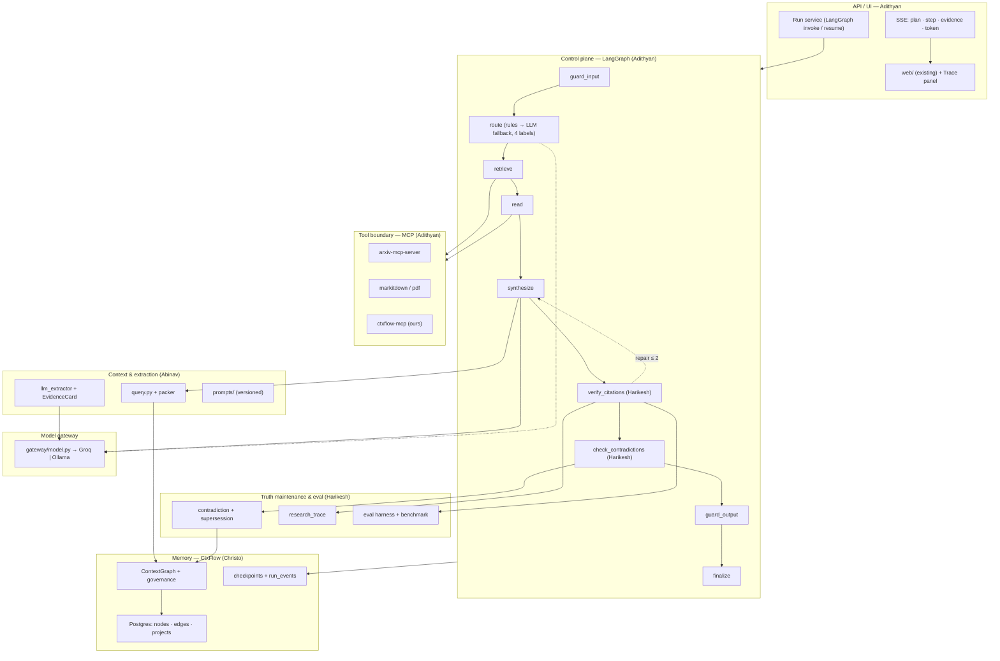

# ResearchOS MVP — Implementation Plan

**Status:** Draft for team review · **Owner:** all four · **Horizon:** 7 sprints + 1 freeze week
**Starts:** Mon 26 Oct 2026 · **Code freeze:** Fri 11 Dec 2026 · **Demo/defense buffer:** 14–18 Dec 2026
**Baseline:** `120 passed, 1 skipped` on `main` (`34cf19f`) as of 25 Oct 2026.

This document is the working plan for the semester MVP. It maps the proposal (`docs/ResearchOS_FYP_Proposal.docx`) and the layer split (`CODEBASE_LAYERS_AND_OWNERSHIP.md`) onto the code that actually exists today, and it assigns every deliverable to exactly one owner.

---

## 0. How to use this document

1. Read §1–§9 once, together. They are the shared contract.
2. Work only from your own section (§7) plus the sprint table (§13).
3. If a contract in §12 must change, open `docs/adr/NNN-*.md`, get one approval, then change the stub **and** the contract test in the same PR. No silent interface drift.
4. Anything not in §1 is out of scope. New ideas go to §17 (deferred), not into a branch.

---

## 1. MVP definition

The MVP is **one vertical slice that runs end to end, is guarded, and is measured** — not a platform.

> A researcher opens a project, asks *"Is claim X still supported by the literature?"*, and receives an answer where every sentence is traceable to a graph node, superseded claims are flagged, and the run can be replayed step by step.

### 1.1 Demo script (the acceptance test)

| # | Step | Pass condition |
|---|---|---|
| 1 | Create project, ingest 12–15 papers from one sub-literature (agent memory) | ≥ 150 claim nodes, no duplicate papers |
| 2 | Ask a question whose answer changed across papers | Answer reflects the **current** claim, not the superseded one |
| 3 | Open Research Trace | Shows supporting chain, the superseded node, and the contradicting edge |
| 4 | Ask an out-of-scope / injection-style question | Blocked by a guardrail with a visible reason, no tool call |
| 5 | Kill the model provider mid-run | Run degrades to graph-only "safe mode", no 500, trace explains why |
| 6 | Re-run steps 2–3 twice | Same plan, same cited node IDs (prose may differ) |

Steps 1–6 must run in **under 90 s** on a warm cache.

### 1.2 Non-goals for the MVP

No skill marketplace, no user accounts/RBAC beyond `project_id`, no experiment manager, no multi-tenant billing, no fine-tuning, no adaptive/learned routing, no more than four agents, no more than four external MCP servers.

---

## 2. Scope swap vs. the proposal (read this first)

The proposal's §6 explicitly **defers** MCP integration and LangGraph/LangChain adapters. This plan **promotes both into the MVP**, because they are now the requested architecture. That is a deliberate trade, and it costs roughly 8–10 engineer-days per person. To keep the semester defensible, the following move to the deferred column **immediately**:

| Cut from MVP | Why | Where it goes |
|---|---|---|
| Separate `frontend/` app (React/Next) | Existing `src/researchos/web/` already renders chat + graph | Extend the existing UI only |
| Baseline B (4-agent flat RAG) as a separate build | Reuses the same agents; only the memory adapter changes | Keep, but implement as a **memory adapter flag**, ~1 day |
| Multi-hop HotpotQA/MuSiQue recall test | Secondary metric in the proposal | Deferred; report as future work |
| User trust study / LLM-judge proxy | Already marked "cut first" | Deferred |
| Semantic Scholar direct integration | Duplicated by an MCP server | Deleted from the critical path |
| Embedding scoring signal in `query.py` | `embedding_enabled=False` today, no model in CI | Deferred to post-MVP |

**Rule:** any new request during the semester goes to §17. The proposal's own risk register names scope creep as the #1 risk; this table is how we honour it.

---

## 3. Reality check: what already exists

The ownership doc is **stale**. Most of `src/researchos/` is already written and tested; the plan must upgrade it, not create it.

| Component | Doc says | Actual state |
|---|---|---|
| `src/ctxflow/` core | Complete | ✅ Real: `CtxFlow` facade, graph, query (3 signals), pruning, governance, contradiction, serialization |
| `src/ctxflow/memory/` | (not listed) | ✅ Real: `store`, `InMemoryMemoryStore`, `PostgresMemoryStore`, `EventIngestor`, `runtime`, embeddings |
| `src/researchos/agents/` | Planned | ✅ Real: `base`, `router`, `retriever`, `reader`, `synthesizer`, `critic`, `trace` |
| `src/researchos/skills/` | Planned | ✅ Real: `registry` (JSON-Schema validation), `literature_search` (arXiv + S2 + SQLite TTL cache), `paper_reader`, `graph_query`, `review_writer` |
| `src/researchos/api/` | Planned | ✅ Real: `create_app`, SSE `/query/stream`, papers/notes/chat routes, skill listing |
| `src/researchos/web/` | `frontend/` planned | ✅ Real: `index.html`, `app.js`, `styles.css` |
| `src/researchos/eval/` | Planned | ✅ Real: dataset, benchmark, flat-RAG baselines, metrics, CLI |
| LangGraph / LangChain / MCP | Deferred | ❌ Absent — this is the actual new work |
| Guardrails | Not specified | ❌ Absent — second block of new work |

### 3.1 Known landmines in the current code

These will bite during integration. Fix or route around them deliberately.

| Landmine | Where | Consequence | Owner |
|---|---|---|---|
| Agents are **synchronous** (`BaseAgent.run` returns `AgentResult`) inside **async** FastAPI routes | `agents/base.py:130`, `api/server.py` | Blocks the event loop for every LLM/tool call | Adithyan (+ all) |
| `literature_search` uses blocking `urllib.request` (30 s timeout) | `skills/literature_search.py:178, 275` | Same; must become async or move behind MCP | Adithyan |
| Router is keyword-regex only, returns `UNKNOWN` easily | `agents/router.py:86` | Silent fallback to the wrong pipeline | Adithyan |
| `query.py` scores only tag + recency + proximity | `query.py` | No embedding signal; don't promise it in the demo | Abinav |
| `Node.embedding` exists but `embedding_enabled=False` | `models.py:148` | Vector path is untested in CI | Christo |
| `record_access`-style protocol additions break third-party stores | lesson from PR #3 | Add capabilities as **optional**, detect with `getattr` | Christo |
| PR #3 classifier measures **59 %** on its own dataset with a dead `observation` class | PR #3, unmerged | Do **not** put auto-classification on the critical path | Abinav |
| `pyproject.toml` has no `langgraph`, `mcp`, or `langchain*` | `pyproject.toml` | Add an `[orchestration]` extra, keep core light | Adithyan |
| Build artifacts (`*.egg-info`, `__pycache__`) partly tracked | repo root | Noisy diffs during a 4-way merge | Christo |

---

## 4. Architecture decisions

Short ADRs. These are binding for the semester.

**AD-1 — The graph owns control flow; the model owns content.**
LangGraph decides *which node runs next* from a fixed topology. The model only fills typed slots: pick one of four intents, extract claims into a schema, classify a contradiction, draft prose from provided evidence. There is **no free-roaming ReAct loop**, no runtime tool discovery, and no model-authored plan.

**AD-2 — "Deterministic" means the control plane is deterministic, never the tokens.**
Same input + same recorded tool responses ⇒ same node sequence, same retrieved node IDs, same citations. Prose will still vary across provider versions. We test structure, not text (§8). This distinction is the core of the report's methodology chapter.

**AD-3 — One model provider at a time, behind one gateway.**
Groq is the default (fast, open-weight, free tier). Ollama is the offline fallback for the defense. NVIDIA NIM / OpenRouter / HF are *config presets*, not integrations to build. No code path imports a provider SDK directly outside `gateway/model.py`.

**AD-4 — MCP is the only external-tool boundary.**
Every external capability (paper search, PDF fetch/convert) enters through an MCP server, pinned by version. Local Python skills are allowed only for things MCP cannot do (our own graph). Each MCP tool is registered as a `SkillSchema` so agents see one uniform interface.

**AD-5 — Guardrails are graph nodes and middleware, not prompt sentences.**
Input, tool-call, and output checks are executable code with tests. A guardrail that lives only in a system prompt is not a guardrail.

**AD-6 — Evidence or silence.**
Every claim in a final answer carries ≥1 `evidence_id` resolving to a graph node. A claim that cannot be grounded is stripped, not softened. This is the Critic's contract and the measurement target.

**AD-7 — Async-first.**
LangGraph nodes, MCP calls, and API handlers are `async`. Any remaining sync call (existing skills) is invoked via `asyncio.to_thread` and marked `# sync-bridge` so it can be removed later.

**AD-8 — Everything is replayable.**
Each run persists its plan, model decisions, tool I/O hashes, and citations. `RESEARCHOS_REPLAY=<run_id>` re-executes the graph against recorded outputs.

---

## 5. Target architecture



---

## 6. Control plane: LangGraph state and topology

Adithyan owns this file; everyone codes against the state.

```python
# src/researchos/orchestration/state.py
class ResearchState(TypedDict, total=False):
    run_id: str
    project_id: str
    query: str
    intent: Literal["new_literature", "existing_knowledge",
                    "claim_verification", "exploratory_trace"]
    plan: list[PlanStep]              # frozen after route; 1 step per node
    budget: Budget                    # tokens, tool_calls, wall_ms, cost_usd
    evidence: list[EvidenceCard]      # Abinav's contract
    claims: list[Claim]               # text + evidence_ids + confidence
    contradictions: list[ContradictionVerdict]
    draft: str | None
    verdict: GuardVerdict | None
    trace: list[RunEvent]             # append-only, replay source
    retries: dict[str, int]           # per-node repair counter, max 2
    errors: list[ToolError]
    final: Answer | None
```

Rules that make it deterministic:

1. `plan` is computed once by `route` and never mutated; repair loops are edge counters, not replans.
2. Each node declares `allowed_tools` (least privilege). A tool not in the list is rejected before execution.
3. `Budget` is checked in middleware on **every** model call and tool call; exhaustion routes to `guard_output` with a truncation notice, never to an exception.
4. `CHECKPOINT = AsyncPostgresSaver` (official, `langgraph-checkpoint-postgres`), `thread_id = run_id`; `interrupt_before=["commit_memory"]` for any write outside the project sandbox.
5. Retry policy: `max_attempts=2`, exponential 0.5 s, only for `TimeoutError | ToolTransientError | ModelRateLimit`.

---

## 7. Workstreams (per owner)

Each section is self-contained: mission, files, P0 deliverables, the contract you publish, and the definition of done.

### 7.1 Christo — Layer 1: memory substrate & run state

**Mission:** make CtxFlow the durable, isolated, auditable memory that the graph reads and writes.

**Owns:** `src/ctxflow/{models,graph,governance,pruning,serialization}.py`, `src/ctxflow/memory/{store,postgres_store}.py`, `migrations/`, `scripts/`.

**P0 deliverables**

| # | Deliverable | Acceptance |
|---|---|---|
| 1 | `project_id` on nodes/edges + migration; every query filters by it | Cross-project leakage test fails closed |
| 2 | Use `AsyncPostgresSaver` for checkpoints; own its migration + retention policy; add `run_events` append-only table | Kill API mid-run → resume from last node, no duplicate writes |
| 3 | `MemoryStore` capability detection (`getattr`) instead of required methods; optional `record_access` | Existing in-memory + Postgres stores both pass contract tests |
| 4 | Supersession writes atomic: edge insert + status update + `superseded_by` in one transaction | Fault-injection test: no half-applied supersession |
| 5 | Degree caps enforced on **every** edge write path (not just the facade) | Property test: 1 000 random inserts, max degree respected |
| 6 | Compaction runs as maintenance job only (`python -m ctxflow.maintenance`), never inline | Demo query latency unaffected by pruning |
| 7 | Perf budget: query P95 < 150 ms at 10 k nodes; ingest P95 < 50 ms | `scripts/bench_graph.py` output committed |

**Contract you publish (by S0 Fri):** `MemoryStore` protocol, `CheckpointStore` usage notes, `RunEvent` schema, `project_id` convention.

**You consume:** `RunEvent` shape (Adithyan), `EvidenceCard` (Abinav), `ContradictionVerdict` (Harikesh).

**DoD:** `pytest tests/test_graph.py tests/test_governance.py tests/test_serialization.py tests/test_postgres_runtime.py -q` green; migration idempotent (run twice); resume-after-crash demo recorded.

**Watch out:** do not add required methods to `MemoryStore` (PR #3 did exactly this and broke third-party stores). Do not edit `001_*.sql` in place — add new numbered migrations (`005+` is free; PR #3 uses 004).

---

### 7.2 Abinav — Layer 2: context assembly, extraction, prompts

**Mission:** make every token in the prompt earned, and every extracted claim traceable to a page.

**Owns:** `src/ctxflow/query.py`, `src/ctxflow/llm_extractor.py`, `src/researchos/skills/{paper_reader,review_writer}.py`, `src/researchos/agents/synthesizer.py`, new `src/researchos/prompts/`.

**P0 deliverables**

| # | Deliverable | Acceptance |
|---|---|---|
| 1 | `EvidenceCard`: `{node_id, paper_id, page, span, text, score, superseded}` — one card per cited claim | Reader produces cards with non-null page for 95 % of claims on the demo corpus |
| 2 | Deterministic packer: sort by score, then `node_id`; bias-aware placement (high salience first/last); hard token cap | Same input ⇒ byte-identical prompt; golden test |
| 3 | `PromptRegistry`: `prompts/<name>@<semver>.md`, SHA-256 exposed as `prompt_hash` | Hash appears in every `RunEvent` that used it |
| 4 | Structured synthesis: output is `claims[]` each with `evidence_ids`; prose assembled from claims | No claim without evidence; validator rejects prose-only output |
| 5 | Paper Reader via MCP (`markitdown`/`arxiv`) with `pymupdf` fallback; page-level offsets preserved | Same PDF through both paths yields same claim count ±10 % |
| 6 | Untrusted-content handling: paper text wrapped in explicit delimiters, instructions inside documents ignored | Injection corpus (5 docs) produces zero instruction-following |
| 7 | Context efficiency: ≥ 40 % token reduction vs full-text stuffing at equal answer correctness | `eval/metrics.py` token_cost_per_query delta |

**Contract you publish (S0 Fri):** `EvidenceCard`, `Claim`, `PromptRegistry.get(name) -> (text, hash)`.

**You consume:** `Memory`/`Node` (Christo), `MCPGateway.call` (Adithyan).

**DoD:** packer + extractor unit tests with frozen fixtures; prompt hash in trace; token-budget test proves no overflow at 1 k / 4 k / 8 k.

**Watch out:** the PR #3 classifier is 59 % accurate — do not use `classify_memory` to route or to gate ingestion. Keep extraction schema-first; free-form JSON parsing is where PR #3 lost reliability.

---

### 7.3 Harikesh — Layer 3: truth maintenance, trace, evaluation

**Mission:** prove that the system knows *what changed its mind*, and measure it honestly.

**Owns:** `src/ctxflow/contradiction.py`, `trace_provenance` in `src/ctxflow/graph.py`, `research_trace` in `src/ctxflow/__init__.py`, `src/researchos/agents/critic.py`, `src/researchos/eval/*`.

**P0 deliverables**

| # | Deliverable | Acceptance |
|---|---|---|
| 1 | Supersession state machine with confidence policy: `≥0.80` auto-supersede, `0.50–0.80` contest, `<0.50` ignore | Policy table unit-tested; every transition written to `run_events` |
| 2 | Contradiction call is schema-constrained: `{relation, confidence, rationale}`; retry once on invalid | Invalid JSON never propagates; 0 uncaught validation errors in 100 runs |
| 3 | `verify_citations` node: resolve each `evidence_id`; unsupported → strip + flag; emit `unsupported_claim_rate` | Metric appears in trace and in eval report |
| 4 | `research_trace` returns supporting chain + contradicting/superseded nodes + per-claim confidence | Demo trace renders ≥1 real supersession from the corpus |
| 5 | Benchmark: ~30 items on one sub-literature, three systems (flat single-agent, flat 4-agent, CtxFlow), metrics per proposal §5.4 | `python -m researchos.eval --systems graph,flat,flat_multi --replay` reproduces numbers |
| 6 | Red-team set: 10 adversarial/ambiguous claim pairs, precision & recall reported with confidence intervals | Report states the bad cases explicitly |
| 7 | Determinism measurement: 20 identical runs → plan hash equality, citation Jaccard ≥ 0.95 | Numbers in the eval report |

**Contract you publish (S0 Fri):** `ContradictionVerdict`, `TraceView`, metric definitions (`correction_propagation`, `provenance_precision`, `unsupported_claim_rate`).

**You consume:** `EvidenceCard` (Abinav), `MemoryStore` (Christo), `RunEvent` (Adithyan).

**DoD:** benchmark report committed under `docs/eval/`; supersession transitions auditable; Critic has ≥ 8 tests including "draft cites superseded node" and "draft cites nonexistent node".

**Watch out:** target is *honest measurement*, not a flattering number. Proposal §9 already commits to reporting detection precision/recall as-is.

---

### 7.4 Adithyan — Layer 4: orchestration, MCP, serving, UI

**Mission:** turn five independent Python modules into one guarded, replayable pipeline behind a stable API.

**Owns:** new `src/researchos/{orchestration,mcp,guardrails,gateway}/`, `src/researchos/skills/{registry,literature_search,graph_query}.py`, `src/researchos/agents/{base,router,retriever}.py`, `src/researchos/api/*`, `src/researchos/web/*`.

**P0 deliverables**

| # | Deliverable | Acceptance |
|---|---|---|
| 1 | LangGraph app + `AsyncPostgresSaver` + budget/retry middleware | Nodes run in fixed order; budget exhaustion degrades gracefully |
| 2 | `MCPGateway`: `langchain-mcp-adapters` (`MultiServerMCPClient`), per-node allowlist, 20 s timeout, 3-failure circuit breaker, TTL cache, audit log | Tool disabled mid-run → run completes via fallback; audit row per call |
| 3 | `ModelGateway`: one OpenAI-compatible client, provider presets (groq/ollama/nvidia/openrouter/hf), structured outputs, token accounting | Swap provider by env var only; no provider import outside `gateway/` |
| 4 | Router: rules first; LLM fallback **only** for `UNKNOWN`, constrained to 4 labels, temp 0, confidence < 0.7 ⇒ default plan | 100-query fixture: plan stability 100 %, wrong-branch rate < 10 % |
| 5 | Guardrails: `guard_input`, tool-arg validator, `guard_output`, safe mode (`RESEARCHOS_SAFE_MODE=1`) | Red-team suite (§9) green |
| 6 | API: `POST /runs`, `GET /runs/{id}/events` (SSE), `GET /runs/{id}`, `POST /runs/{id}/resume`, `GET /runs/{id}/trace`; cancel + idempotency key | Two identical POSTs → one run |
| 7 | Async migration: existing agents callable from graph via `asyncio.to_thread`; no blocking call on the loop | `test_no_blocking_io` fails if `urllib`/`time.sleep` on event loop |
| 8 | Trace panel in existing `web/`: plan timeline, evidence list, contradictions in red, blocked-step badge | Demo step 3 passes without dev tools |

**Contract you publish (S0 Fri):** `ResearchState`, `RunEvent`, `MCPGateway.call`, `ModelGateway.complete`, `GuardVerdict`.

**You consume:** all three other contracts.

**DoD:** `make demo` runs steps 1–6 unaided; P95 < 12 s warm / < 25 s cold; zero unhandled 500s in a 50-query fuzz.

**Watch out:** MCP servers are **spawned processes**. Pin versions, never `npx -y latest`, run with a restricted env, and cap output bytes. A compromised MCP server is arbitrary code execution on the demo laptop.

---

## 8. Determinism contract

| Decision point | Who decides | Constraint | Fallback |
|---|---|---|---|
| Intent (4 labels) | Model allowed | `temperature=0`, `top_p=1`, JSON schema enum, rules take precedence | Default `existing_knowledge` |
| Which papers to fetch | Rules (`retriever` heuristics) | Max 5, allowlisted sources | Skip retrieval |
| Claim extraction | Model | JSON schema, `EvidenceCard` required fields | Drop malformed claim |
| Contradiction | Model | 3 labels + confidence; policy thresholds in code | `ignore` |
| Citation acceptance | Code | `evidence_id` must exist | Strip claim |
| Answer prose | Model | Only from provided evidence | Template synthesis (safe mode) |

**Recorded, not hoped for:** `run_events` stores `prompt_hash`, `model_id`, `tool`, `args_hash`, `output_hash`, `duration_ms`, `cache_hit`. `RESEARCHOS_REPLAY=<run_id>` feeds those back. Determinism tests assert **plan + citations**, never prose.

**Explicitly accepted non-determinism:** tokenizer drift across providers, provider-side model updates, floating-point ordering in embeddings. Report these as limitations.

---

## 9. Guardrails

| ID | Layer | Threat | Control | Owner | Test |
|---|---|---|---|---|---|
| G1 | Input | Prompt injection via query | Normalise, strip control tokens, length cap 8 k, injection classifier + heuristics | Adithyan | `test_guard_input_injection` |
| G2 | Input | Cross-project data access | `project_id` from request context; every store call scoped | Christo | `test_project_isolation` |
| G3 | Tool | Over-broad tool use | Per-node allowlist; unknown tool → reject before call | Adithyan | `test_tool_allowlist` |
| G4 | Tool | Malformed/hostile args | JSON-Schema validation, ID regex, path containment | Adithyan | `test_tool_arg_schema` |
| G5 | Tool | SSRF / egress | Domain allowlist (`arxiv.org`, `export.arxiv.org`, `api.openalex.org`), block private IPs, 20 MB cap, content-type check | Adithyan | `test_egress_allowlist` |
| G6 | Ops | Cost / runaway loops | Max 12 tool calls, 60 k tokens, 90 s wall, $0.02/query | Adithyan | `test_budget_exhaustion` |
| G7 | Model | Invalid structured output | Schema validate → 1 repair → fallback label | Abinav | `test_structured_output_repair` |
| G8 | Output | Ungrounded claims | Every claim resolves to evidence, else stripped | Harikesh | `test_citation_verifier` |
| G9 | Output | Superseded answer served as current | Contradiction gate before finalize | Harikesh | `test_superseded_gate` |
| G10 | Write | Destructive actions | `interrupt_before=commit_memory`; explicit resume | Adithyan | `test_hitl_resume` |
| G11 | Ops | No audit trail | Append-only `run_events`, hash-chained per run | Christo | `test_event_chain` |
| G12 | Ops | Provider outage | Safe mode: graph-only answers, banner, no silent failure | Adithyan | `test_safe_mode` |

**Red-team suite (must stay green):** 10 injection prompts, 5 malicious PDFs, 1 oversized download, 1 tool returning 10 MB, 1 provider timeout, 1 provider 500, 1 malformed JSON, 1 claim citing a deleted node.

---

## 10. MCP & skills plan

### 10.1 External MCP servers (pinned, allowlisted)

| Server | Purpose | Licence | Pin | Transport | Owner |
|---|---|---|---|---|---|
| `arxiv-mcp-server` | search + fetch + store papers | Apache-2.0 | `0.8.2` (PyPI, official MCP registry) | stdio (`uvx --from arxiv-mcp-server[pdf]`) | Adithyan |
| `paper-search-mcp` (openags) — optional | OpenAlex/Crossref metadata, DOI resolution | MIT | pin at adoption | stdio | Adithyan |
| `markitdown-mcp` (Microsoft) | PDF/DOCX → markdown | MIT | verify + pin at adoption | stdio | Abinav |
| `ctxflow-mcp` (**ours**) | `memory.search`, `memory.trace`, `memory.ingest_note` | MIT | local | stdio | Adithyan + Christo |

Rules: one server per capability, no overlaps; every pin in `mcp_servers.yaml` with `version`, `licence`, `allowed_tools`, `timeout_s`, `max_output_bytes`, `requires_approval`; a server that fails the smoke test is disabled for the run, never retried forever.

### 10.2 Skills

Two tiers, one registry:

- **Tool skills** — MCP tools wrapped as `SkillSchema` (JSON Schema from MCP `inputSchema`), namespaced `mcp.<server>.<tool>`.
- **Procedure skills** — Agent Skills format (`SKILL.md`, YAML frontmatter + instructions), following the open format published in `anthropics/skills` (Apache-2.0 core skills). We author our own: `literature-triage`, `claim-extraction`, `evidence-synthesis`, `contradiction-audit`, `review-format`.

Licensing note: several document skills in `anthropics/skills` (`docx`, `pdf`, `pptx`, `xlsx`) are **source-available, not open source** — do not vendor them. Use the format, write our own content.

### 10.3 MCP operating rules

1. No unpinned `npx`/`uvx` in CI or demo; lockfile committed.
2. Restricted env: MCP subprocesses get only the keys they need (never the model key).
3. Output caps + timeouts on every call; failures become `ToolError` in state, not exceptions.
4. Cache by `(server, tool, args_hash)` with TTL; 7 days for literature, 24 h for conversions.
5. Audit row per call: args hash, bytes in/out, duration, cache hit, server version.

---

## 11. Model gateway

```toml
# pyproject.toml — new extra, core stays light
[project.optional-dependencies]
orchestration = ["langgraph>=0.2", "langchain-core>=0.3", "langgraph-checkpoint-postgres>=2.0"]
mcp = ["langchain-mcp-adapters>=0.1", "mcp>=1.0"]
```

| Env var | Values | Default |
|---|---|---|
| `RESEARCHOS_MODEL_PROVIDER` | `groq` \| `ollama` \| `nvidia` \| `openrouter` \| `hf` | `groq` |
| `RESEARCHOS_MODEL_ID` | e.g. `openai/gpt-oss-20b`, `qwen3:8b` | per preset |
| `RESEARCHOS_MODEL_TIMEOUT_S` | seconds | `20` |
| `RESEARCHOS_MAX_RETRIES` | attempts | `2` |
| `RESEARCHOS_SAFE_MODE` | `0/1` | `0` |
| `RESEARCHOS_REPLAY` | `run_id` | unset |

Provider presets live in one dict; **only** `gateway/model.py` imports `openai`. Temperature is `0` everywhere; `max_tokens=512`; JSON-schema response format where supported, otherwise parse + one repair.

**System-1 discipline:** short prompts, no chain-of-thought requests, no self-critique loops, one call per node. If a node needs two model calls, it is designed wrong.

Cost guard: each run accumulates `prompt_tokens + completion_tokens`; the eval report includes cost per query for all three systems.

---

## 12. Interface freeze & integration

**Freeze date: Friday 30 Oct 2026, 18:00.** After that, contract changes need an ADR.

| Contract | File | Publisher | Consumers |
|---|---|---|---|
| `ResearchState`, `RunEvent`, `Budget` | `researchos/orchestration/state.py` | Adithyan | all |
| `EvidenceCard`, `Claim` | `researchos/evidence.py` | Abinav | Harikesh, Adithyan |
| `MCPGateway.call(tool, args) -> ToolResult` | `researchos/mcp/gateway.py` | Adithyan | Abinav, Christo |
| `ModelGateway.complete(...)` | `researchos/gateway/model.py` | Adithyan | Abinav, Harikesh |
| `GuardVerdict`, `Guard` | `researchos/guardrails/base.py` | Adithyan | Harikesh |
| `MemoryStore`, `RunEvent` persistence | `ctxflow/memory/store.py`, `migrations/` | Christo | all |
| `ContradictionVerdict`, `TraceView` | `ctxflow/contradiction.py`, `ctxflow/models.py` | Harikesh | Adithyan, Abinav |

**Rules:** directory ownership is exclusive (no cross-edits without a PR comment); PRs ≤ 400 changed lines; every PR that touches a contract also touches `tests/contract/`; `main` stays green; feature flags (`RESEARCHOS_USE_GRAPH_ROUTER=1`) for anything half-done.

---

## 13. Sprint plan

Dates are Mondays. Every Friday: 15-minute integration demo on `main`, no slides.

| Sprint | Adithyan (L4) | Christo (L1) | Abinav (L2) | Harikesh (L3) |
|---|---|---|---|---|
| **S0** 26–30 Oct | Contract stubs; spike LangGraph+MCP+Groq (2 days); `mcp_servers.yaml` | Freeze `MemoryStore`; `project_id` design; checkpoint table plan | `EvidenceCard`/`Claim` stubs; prompt registry layout | `ContradictionVerdict`/`TraceView` stubs; benchmark corpus list |
| **S1** 2–6 Nov | LangGraph skeleton, 8 nodes, budget middleware, SSE events | `project_id` migration; `run_events`; `AsyncPostgresSaver` wiring | Packer v1 + golden prompts; extractor → `EvidenceCard` | Supersession state machine + policy; critic skeleton |
| **S2** 9–13 Nov | MCP gateway + arxiv server + allowlist + cache | Atomic supersession transaction; degree-cap property test | Paper reader via MCP + pymupdf fallback; page spans | `verify_citations` node; trace API v1 |
| **S3** 16–20 Nov | Model gateway + router v2 (rules+LLM fallback) | Resume-after-crash demo; retention policy | Structured synthesis (claims→prose); injection delimiters | Benchmark v1 (30 items) + three systems wired |
| **S4** 23–27 Nov | Guardrails G1–G6 + safe mode; `ctxflow-mcp` server | Perf pass (10 k nodes) + `scripts/bench_graph.py` | Token-efficiency measurement; prompt hash in trace | Red-team set; `unsupported_claim_rate`; trace UI data |
| **S5** 30 Nov–4 Dec | API hardening, idempotency, cancel; trace UI panel | Isolation + migration idempotency tests; backup/restore script | Golden prompt regression suite; extraction precision on corpus | Full eval run; determinism (20 runs); report v1 |
| **S6** 7–11 Dec | End-to-end demo hardening; fuzz 50 queries; latency | Demo corpus ingest; graph stats; docs | Prompt/cost tuning within budget; docs | Final report numbers; limitations section |
| **S7** 14–18 Dec | Freeze, demo script rehearsal, rollback plan | Backup/restore rehearsal | Demo corpus freeze | Report polish + defense slides |

### 13.1 Milestones

| ID | Date | Gate |
|---|---|---|
| M1 | 30 Oct | Contracts frozen, spikes green, benchmark corpus chosen |
| M2 | 13 Nov | Graph runs end-to-end with MCP retrieval, no guardrails yet |
| M3 | 27 Nov | Guardrails on, trace visible in UI, supersession demonstrated |
| M4 | 4 Dec | Determinism + free-format eval numbers exist |
| M5 | 11 Dec | `make demo` passes all six acceptance steps |
| M6 | 18 Dec | Frozen build + report |

---

## 14. Definition of Done

A deliverable is done when **all** are true:

- [ ] Tests cover the happy path and one failure path; `pytest -q` green on `main`.
- [ ] No blocking I/O on the event loop (or explicitly bridged and marked).
- [ ] Structured output validated, never `json.loads` on raw model text without a guard.
- [ ] Every external call has a timeout, a retry bound, and a fallback.
- [ ] Secrets only from env; `.env.example` updated with placeholders.
- [ ] Docs updated: `README.md` claim matches behaviour (no aspirational statements).
- [ ] Trace shows the new step with a stable event name.
- [ ] Cost/latency impact noted in the PR description.

**Demo acceptance:** §1.1 steps 1–6, run twice, second run from warm cache.

---

## 15. Testing & CI

| Layer | What | Gate |
|---|---|---|
| Unit | Each module, frozen fixtures | Every PR |
| Contract | `tests/contract/`: state, evidence, gateway, store | Every PR touching contracts |
| Determinism | Same fixture × 20 → identical plan hash + citation Jaccard ≥ 0.95 | Nightly + release |
| Guardrail | Red-team suite (§9) | Every PR touching guards |
| Integration | Real Postgres + real MCP servers (marked `live`) | Nightly, not PR |
| Eval | `python -m researchos.eval --replay` | Release |
| Latency | P50/P95 from `scripts/bench_*` | Release |

CI jobs: `lint` (ruff), `type` (mypy on new packages only), `test` (offline), `contract`, `guardrails`, `nightly-live`. Live jobs never block a PR, but a red nightly blocks the weekly demo.

---

## 16. Risks

| Risk | Likelihood | Impact | Mitigation | Owner |
|---|---|---|---|---|
| Scope creep (proposal's #1 risk) | High | High | §2 cut list is binding; new asks → §17 | All |
| MCP server breakage / unpinned update | Medium | High | Pins, circuit breaker, local fallback skill, `ctxflow-mcp` under our control | Adithyan |
| Provider outage during demo | Medium | High | Ollama offline preset + safe mode; rehearse airplane-mode demo | Adithyan |
| Model non-determinism leaks into eval | High | Medium | Replay + structural assertions; report prose variance honestly | Harikesh |
| 4-way merge conflicts | Medium | Medium | Directory ownership, contract freeze, ≤400 LOC PRs | All |
| Benchmark too small to be credible | Medium | High | 30 items minimum, one sub-literature, confidence intervals | Harikesh |
| Contradiction detection unreliable | High | Medium | Narrow curated set, threshold policy, report P/R as-is | Harikesh |
| Sync code reintroduced into async path | Medium | Medium | `test_no_blocking_io`, review checklist | Adithyan |
| Heavy deps bloat install (PR #3 lesson) | Medium | Low | `[orchestration]`/`[mcp]` extras only; core stays `networkx/asyncpg/pydantic/dotenv` | Christo |

---

## 17. Deferred (post-MVP, explicitly labelled as roadmap)

Personalized PageRank · Louvain/Leiden compaction · dense-vector hybrid retrieval · adaptive/learned routing · >4 agents · skill marketplace UI · multi-tenant auth & RBAC · experiment manager · timeline/task planner · fine-tuning · user trust study · multi-hop benchmark · direct Semantic Scholar client · separate React frontend.

---

## Appendix A — Environment template

```dotenv
# --- database ---
DB_HOST=localhost
DB_PORT=5432
DB_NAME=ctxflow
DB_USER=ctxflow
DB_PASSWORD=change_me

# --- model (choose ONE provider) ---
RESEARCHOS_MODEL_PROVIDER=groq          # groq | ollama | nvidia | openrouter | hf
RESEARCHOS_MODEL_ID=openai/gpt-oss-20b
RESEARCHOS_MODEL_TIMEOUT_S=20
RESEARCHOS_MAX_RETRIES=2
GROQ_API_KEY=

# --- offline fallback ---
# RESEARCHOS_MODEL_PROVIDER=ollama
# RESEARCHOS_MODEL_ID=qwen3:8b
# OLLAMA_BASE_URL=http://localhost:11434/v1

# --- MCP ---
RESEARCHOS_MCP_CONFIG=./mcp_servers.yaml
RESEARCHOS_MCP_TIMEOUT_S=20
RESEARCHOS_MCP_MAX_OUTPUT_BYTES=2000000

# --- guardrails / ops ---
RESEARCHOS_SAFE_MODE=0
RESEARCHOS_MAX_TOOL_CALLS=12
RESEARCHOS_MAX_TOKENS=60000
RESEARCHOS_MAX_WALL_MS=90000
RESEARCHOS_LOG_LEVEL=INFO
```

## Appendix B — Target file map (new files only)

```
src/researchos/
├── orchestration/
│   ├── state.py            # ResearchState, RunEvent, Budget   [Adithyan]
│   ├── graph.py            # StateGraph wiring, edges, retries [Adithyan]
│   ├── nodes.py            # thin node adapters                [Adithyan]
│   └── checkpoints.py      # AsyncPostgresSaver setup          [Christo/Adithyan]
├── gateway/
│   └── model.py            # provider presets, structured out  [Adithyan]
├── mcp/
│   ├── gateway.py          # MultiServerMCPClient wrapper      [Adithyan]
│   ├── config.py           # mcp_servers.yaml loader/validator [Adithyan]
│   └── server.py           # ctxflow-mcp (ours)                [Adithyan/Christo]
├── guardrails/
│   ├── base.py             # Guard, GuardVerdict               [Adithyan]
│   ├── input.py  tool.py  output.py  budget.py                 [Adithyan]
├── evidence.py             # EvidenceCard, Claim               [Abinav]
└── prompts/                # <name>@<semver>.md + hashes       [Abinav]

tests/contract/             # frozen interface tests            [All]
mcp_servers.yaml            # pinned servers + allowlists        [Adithyan]
docs/adr/                   # binding decisions                 [All]
docs/eval/                  # benchmark reports                 [Harikesh]
```

## Appendix C — Ownership at a glance

| Person | Layer | Primary files | One-line mission |
|---|---|---|---|
| Christo | L1 | `ctxflow/models.py`, `graph.py`, `governance.py`, `pruning.py`, `memory/store.py`, `postgres_store.py`, `migrations/` | Durable, isolated, auditable memory + resumable state |
| Abinav | L2 | `ctxflow/query.py`, `llm_extractor.py`, `skills/paper_reader.py`, `agents/synthesizer.py`, `prompts/` | Maximum signal per token, every claim traceable |
| Harikesh | L3 | `contradiction.py`, `trace_provenance`, `agents/critic.py`, `eval/` | Truth maintenance + honest measurement |
| Adithyan | L4 | `orchestration/`, `mcp/`, `guardrails/`, `gateway/`, `agents/router.py`, `api/`, `web/` | One guarded, replayable pipeline behind a stable API |
